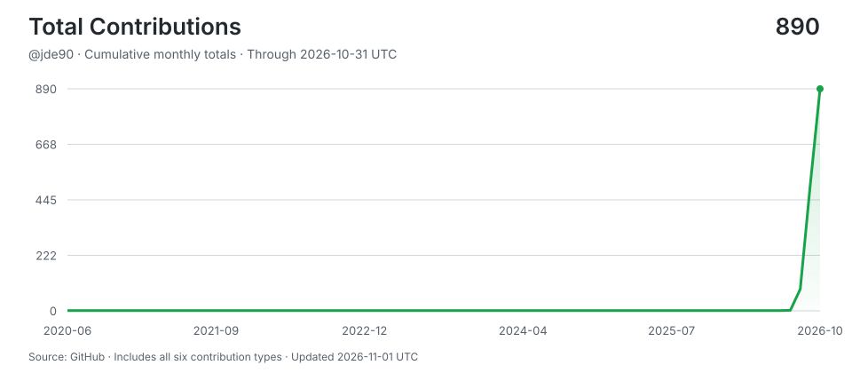

# jde90

<!-- aidevops:badges:start -->
<!-- managed by aidevops badges; edit the template, not this block -->

<!-- aidevops:badges:end -->

> Shipping with AI agents around the clock -- human hours for thinking, machine hours for doing.
>
> Stats auto-updated by [aidevops](https://aidevops.sh).

<!-- STATS-START -->
## Work with AI

| Metric | Yesterday | Prior 7 Days | Prior 28 Days | Prior 365 Days |
| --- | ---: | ---: | ---: | ---: |
| Screen time (Mac) | 4.9h | 19.5h | 119.4h | ~1806h* |
| Interactive human attention | 3.5h | 9.0h | 71.1h | 438.0h |
| Interactive AI generation | 7.8h | 18.3h | 149.1h | 709.4h |
| Worker-classified human attention | 0.0h | 0.0h | 0.0h | 0.9h |
| Worker/headless AI generation | 1.3h | 12.9h | 59.2h | 163.2h |
| Additive observed work | 12.6h | 40.1h | 279.5h | 1,311.3h |
| Interactive sessions | 17 | 43 | 181 | 607 |
| Worker sessions | 21 | 252 | 829 | 3,455 |

_Screen time from screen-time-history:daily-observations; collection status: ok. *365-day estimate uses observed calendar coverage._

_Periods are completed local calendar days ending at midnight; today is excluded._

_Human attention is unioned wall-clock time, so overlapping sessions are not double-counted. AI generation is additive machine work across sessions; it is not wall-clock concurrency._

_AI session 365-day totals cover 129 days of local assistant session history (not extrapolated)._

## AI Model Usage (last 30 days)

| Model | Requests | Input | Output | Cache read | Cache write | Cache Hit-Rate % | Session Count | Session Hours |
| --- | ---: | ---: | ---: | ---: | ---: | ---: | ---: | ---: |
| claude-opus-5 | 21,010 | 42K | 5.7M | 3,740.3M | 125.9M | 96.7% | 811 | 70.9h |
| claude-opus-5-5 | 10,243 | 25K | 4.0M | 2,201.8M | 79.1M | 96.5% | 37 | 55.2h |
| gpt-5.6-luna | 6,063 | 46.3M | 6.0M | 21.1M | 0 | 31.3% | 237 | 20.7h |
| claude-sonnet-5-5 | 5,855 | 14K | 2.2M | 1,236.8M | 63.2M | 95.1% | 46 | 21.7h |
| gpt-6.1-sol | 4,800 | 14.3M | 1.0M | 750.0M | 0 | 98.1% | 20 | 32.7h |
| claude-sonnet-5 | 2,408 | 4K | 869K | 639.2M | 28.9M | 95.7% | 18 | 10.8h |
| gpt-5.6-terra | 1,474 | 17.2M | 515K | 111.1M | 0 | 86.6% | 112 | 10.6h |
| big-pickle | 1,079 | 7.7M | 235K | 129.9M | 0 | 94.4% | 12 | 5.0h |
| gpt-6-luna | 852 | 6.5M | 142K | 118.3M | 0 | 94.7% | 24 | 3.5h |
| deepseek-v4-pro | 190 | 538K | 71K | 35.2M | 0 | 98.5% | 1 | 0.6h |
| gpt-5.6-sol | 110 | 233K | 11K | 19.0M | 0 | 98.8% | 1 | 0.4h |
| deepseek-v4.1-flash-free | 101 | 1.5M | 18K | 14.6M | 0 | 90.6% | 4 | 0.3h |
| nemotron-3-ultra-free | 43 | 940K | 2K | 4.7M | 0 | 83.6% | 2 | 0.1h |
| gpt-6.1-terra | 24 | 67K | 3K | 1.4M | 0 | 95.4% | 1 | 0.0h |
| glm-5.3-flash-free | 8 | 152K | 342 | 1.0M | 0 | 87.1% | 1 | 0.0h |
| pool-account-management | 1 | 0 | 0 | 0 | 0 | 0.0% | 1 | 0.0h |
| **Total** | **54,261** | **95.7M** | **21.0M** | **9,025.1M** | **297.3M** | **95.8%** | **1,069** | **232.5h** |

_9,439.2M total tokens processed. 95.8% cache hit rate._

## AI Model Usage (all time)

| Model | Requests | Input | Output | Cache read | Cache write | Cache Hit-Rate % | Session Count | Session Hours |
| --- | ---: | ---: | ---: | ---: | ---: | ---: | ---: | ---: |
| claude-opus-5 | 49,154 | 98K | 18.4M | 10,765.3M | 413.4M | 96.3% | 1,475 | 199.4h |
| claude-sonnet-5 | 32,839 | 67K | 15.8M | 11,513.9M | 467.5M | 96.1% | 292 | 152.1h |
| gpt-5.6-sol | 15,334 | 70.0M | 3.4M | 1,270.5M | 0 | 94.8% | 800 | 80.3h |
| claude-opus-5-5 | 11,076 | 27K | 4.5M | 2,377.1M | 86.5M | 96.5% | 47 | 60.3h |
| big-pickle | 10,413 | 52.1M | 4.0M | 1,023.3M | 0 | 95.2% | 147 | 53.6h |
| gpt-5.6-luna | 7,730 | 74.2M | 6.3M | 163.5M | 0 | 68.8% | 743 | 29.8h |
| claude-sonnet-5-5 | 5,855 | 14K | 2.2M | 1,236.8M | 63.2M | 95.1% | 46 | 21.7h |
| claude-opus-4-8 | 5,837 | 11K | 6.9M | 1,606.9M | 98.3M | 94.2% | 46 | 42.5h |
| gpt-6.1-sol | 4,800 | 14.3M | 1.0M | 750.0M | 0 | 98.1% | 20 | 32.7h |
| gpt-5.6-terra | 3,394 | 34.6M | 982K | 258.9M | 0 | 88.2% | 316 | 19.3h |
| deepseek-v4-flash-free | 3,290 | 10.5M | 1.1M | 331.3M | 0 | 96.9% | 37 | 14.8h |
| gpt-5.5 | 2,285 | 8.8M | 389K | 140.5M | 0 | 94.1% | 301 | 9.8h |
| gpt-6-luna | 852 | 6.5M | 142K | 118.3M | 0 | 94.7% | 24 | 3.5h |
| claude-sonnet-4-6 | 360 | 468 | 254K | 62.6M | 3.4M | 94.8% | 3 | 1.8h |
| claude-opus-4-6 | 255 | 305 | 160K | 51.4M | 2.5M | 95.3% | 2 | 1.6h |
| muse-spark-1.2-contributor-free | 228 | 1.7M | 47K | 59.0M | 0 | 97.1% | 1 | 0.5h |
| deepseek-v4-pro | 211 | 951K | 81K | 41.3M | 0 | 97.8% | 3 | 0.8h |
| gpt-6-astra | 210 | 1.5M | 68K | 23.9M | 0 | 94.0% | 5 | 1.3h |
| claude-fable-5 | 187 | 374 | 159K | 32.6M | 2.8M | 91.9% | 6 | 1.2h |
| nemotron-3-ultra-free | 109 | 3.0M | 8K | 9.3M | 0 | 75.6% | 5 | 0.8h |
| longcat-2.5-preview-free | 102 | 149K | 9K | 12.3M | 0 | 98.8% | 1 | 0.3h |
| deepseek-v4.1-flash-free | 101 | 1.5M | 18K | 14.6M | 0 | 90.6% | 4 | 0.3h |
| deepseek-v4-flash | 71 | 178K | 26K | 13.5M | 0 | 98.7% | 1 | 0.1h |
| gpt-5.4-mini | 53 | 1.3M | 4K | 4.0M | 0 | 75.1% | 1 | 1.2h |
| nemotron-3.5-lightning-free | 29 | 930K | 12K | 1.7M | 0 | 65.5% | 6 | 0.3h |
| muse-spark-1.3-contributor-free | 27 | 114K | 4K | 2.2M | 0 | 95.1% | 2 | 0.0h |
| gpt-6.1-terra | 24 | 67K | 3K | 1.4M | 0 | 95.4% | 1 | 0.0h |
| glm-5.3-flash-free | 8 | 152K | 342 | 1.0M | 0 | 87.1% | 1 | 0.0h |
| claude-haiku-4-5 | 5 | 17 | 1K | 103K | 415K | 20.0% | 4 | 0.0h |
| mimo-v2.5-free | 5 | 454K | 3K | 16K | 0 | 3.5% | 5 | 0.0h |
| qwen2.5:14b-instruct-q4_K_M | 3 | 6K | 408 | 0 | 0 | 0.0% | 1 | 0.0h |
| gpt-5.6 | 2 | 0 | 0 | 0 | 0 | 0.0% | 2 | 0.0h |
| gpt-5.6-fast | 2 | 0 | 0 | 0 | 0 | 0.0% | 2 | 0.0h |
| pool-account-management | 2 | 0 | 0 | 0 | 0 | 0.0% | 2 | 0.0h |
| claude-fable-5-1 | 1 | 0 | 0 | 0 | 0 | 0.0% | 1 | 0.1h |
| claude-opus-4-8-fast | 1 | 0 | 0 | 0 | 0 | 0.0% | 1 | 0.0h |
| **Total** | **154,855** | **283.7M** | **66.5M** | **31,888.6M** | **1,138.4M** | **95.7%** | **3,867** | **730.3h** |

_33,377.3M total tokens processed. 95.7% cache hit rate._
<!-- STATS-END -->

## Projects

- **[huszka-weightlifting](https://github.com/jde90/huszka-weightlifting)** -- No description
- **[expired-gmb-domains](https://github.com/jde90/expired-gmb-domains)** -- Expired GMB Domains finds registerable and auction domains, verifies their availability, and surfaces exact Google Business Profile signals, so you can focus on names with evidence behind them.
- **[concrete-contractors-kenosha](https://github.com/jde90/concrete-contractors-kenosha)** -- Concrete Contractors Kenosha - static site for Cloudflare Pages
- **[concrete-contractors-dayton](https://github.com/jde90/concrete-contractors-dayton)** -- Concrete Contractors Dayton Ohio - static site
<!-- CONTRIBUTIONS-START -->
## Contributions

- **[aidevops](https://github.com/marcusquinn/aidevops)** -- Vibe-Coding is easy. DevOps is hard. OpenCode & Git token-efficient AI agent automation for your app, business, and personal development. Opinionated tools, services, CLI & API stack for speed, security, and 24/7 results. Open-source first. SOTA everything. Try on your repos for money-making magic.
<!-- CONTRIBUTIONS-END -->

## Connect

---

<!-- UPDATED-START -->
_Stats auto-updated 2026-11-01 08:07 UTC by [aidevops](https://aidevops.sh) pulse._
<!-- UPDATED-END -->

<!-- TOTAL-CONTRIBUTIONS-START -->

  <a href="https://commit-history.com/jde90?metric=total" target="_blank" rel="noopener noreferrer">
    <picture>
      <source media="(prefers-color-scheme: dark)" srcset="assets/contributions/total-dark.svg" />
      
    </picture>
  </a>

[Verify on commit-history.com](https://commit-history.com/jde90?metric=total) · [Chart data](assets/contributions/total.json)

Includes commits, issues, pull requests, reviews, repositories, and restricted contributions. Refreshed daily through the prior UTC day; commit-history.com may use a different refresh cutoff. GitHub controls link navigation—Ctrl/Cmd-click opens verification in a new tab.
<!-- TOTAL-CONTRIBUTIONS-END -->
