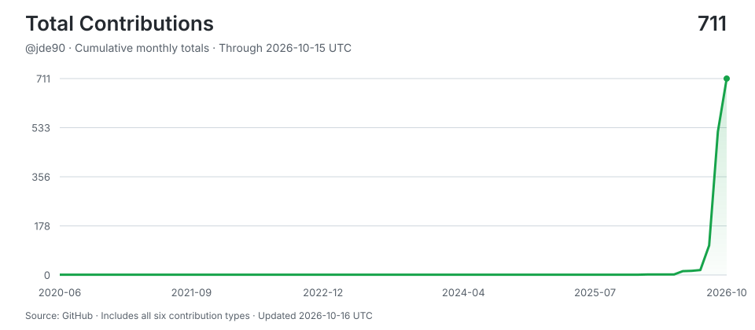

# jde90

> Shipping with AI agents around the clock -- human hours for thinking, machine hours for doing.
>
> Stats auto-updated by [aidevops](https://aidevops.sh).

<!-- STATS-START -->
## Work with AI

| Metric | Yesterday | Prior 7 Days | Prior 28 Days | Prior 365 Days |
| --- | ---: | ---: | ---: | ---: |
| Screen time (Mac) | 0.2h | 30.5h | 157h | ~1868h* |
| Interactive human attention | 0.0h | 18.5h | 95.4h | 416.1h |
| Interactive AI generation | 3.1h | 28.1h | 136.5h | 627.5h |
| Worker-classified human attention | 0.0h | 0.0h | 0.0h | 0.9h |
| Worker/headless AI generation | 0.0h | 8.4h | 51.9h | 129.9h |
| Additive observed work | 3.1h | 55.0h | 283.8h | 1,174.1h |
| Interactive sessions | 17 | 64 | 163 | 547 |
| Worker sessions | 0 | 139 | 742 | 3,044 |

_Screen time from screen-time-history:daily-observations; collection status: ok. *365-day estimate uses observed calendar coverage._

_Periods are completed local calendar days ending at midnight; today is excluded._

_Human attention is unioned wall-clock time, so overlapping sessions are not double-counted. AI generation is additive machine work across sessions; it is not wall-clock concurrency._

_AI session 365-day totals cover 116 days of local assistant session history (not extrapolated)._

## AI Model Usage (last 30 days)

| Model | Requests | Input | Output | Cache read | Cache write | Cache Hit-Rate % | Session Count | Session Hours |
| --- | ---: | ---: | ---: | ---: | ---: | ---: | ---: | ---: |
| claude-opus-5 | 18,000 | 35K | 5.2M | 3,226.1M | 130.6M | 96.1% | 680 | 68.4h |
| claude-sonnet-5 | 7,141 | 14K | 2.8M | 2,046.3M | 91.7M | 95.7% | 33 | 29.8h |
| claude-opus-5-5 | 5,375 | 12K | 2.5M | 1,123.1M | 49.3M | 95.8% | 36 | 22.0h |
| claude-sonnet-5-5 | 3,261 | 7K | 1.3M | 690.0M | 43.5M | 94.1% | 25 | 15.1h |
| gpt-6.1-sol | 2,964 | 8.0M | 694K | 462.0M | 0 | 98.3% | 11 | 19.2h |
| gpt-5.6-luna | 2,247 | 20.8M | 1.9M | 63.2M | 0 | 75.2% | 159 | 9.3h |
| big-pickle | 2,070 | 14.0M | 1.0M | 235.7M | 0 | 94.4% | 25 | 8.1h |
| gpt-5.6-terra | 1,292 | 17.2M | 430K | 103.8M | 0 | 85.8% | 106 | 7.5h |
| gpt-5.6-sol | 865 | 5.1M | 322K | 137.4M | 0 | 96.4% | 7 | 5.9h |
| gpt-6-luna | 835 | 6.3M | 141K | 117.0M | 0 | 94.9% | 22 | 3.5h |
| deepseek-v4-pro | 191 | 646K | 71K | 35.2M | 0 | 98.2% | 2 | 0.6h |
| longcat-2.5-preview-free | 102 | 149K | 9K | 12.3M | 0 | 98.8% | 1 | 0.3h |
| claude-fable-5 | 46 | 92 | 43K | 7.7M | 652K | 92.3% | 2 | 0.4h |
| nemotron-3-ultra-free | 43 | 940K | 2K | 4.7M | 0 | 83.6% | 2 | 0.1h |
| deepseek-v4.1-flash-free | 28 | 213K | 8K | 4.3M | 0 | 95.3% | 1 | 0.1h |
| muse-spark-1.3-contributor-free | 16 | 103K | 2K | 1.3M | 0 | 93.0% | 1 | 0.0h |
| pool-account-management | 2 | 0 | 0 | 0 | 0 | 0.0% | 2 | 0.0h |
| claude-fable-5-1 | 1 | 0 | 0 | 0 | 0 | 0.0% | 1 | 0.1h |
| **Total** | **44,479** | **73.8M** | **16.6M** | **8,270.8M** | **315.9M** | **95.5%** | **908** | **190.4h** |

_8,677.2M total tokens processed. 95.5% cache hit rate._

## AI Model Usage (all time)

| Model | Requests | Input | Output | Cache read | Cache write | Cache Hit-Rate % | Session Count | Session Hours |
| --- | ---: | ---: | ---: | ---: | ---: | ---: | ---: | ---: |
| claude-opus-5 | 38,448 | 77K | 15.6M | 8,960.2M | 358.5M | 96.2% | 1,088 | 165.2h |
| claude-sonnet-5 | 32,839 | 67K | 15.8M | 11,513.9M | 467.5M | 96.1% | 292 | 152.1h |
| gpt-5.6-sol | 15,334 | 70.0M | 3.4M | 1,270.5M | 0 | 94.8% | 800 | 80.3h |
| big-pickle | 10,413 | 52.1M | 4.0M | 1,023.3M | 0 | 95.2% | 147 | 53.6h |
| claude-opus-4-8 | 5,837 | 11K | 6.9M | 1,606.9M | 98.3M | 94.2% | 46 | 42.5h |
| claude-opus-5-5 | 5,375 | 12K | 2.5M | 1,123.1M | 49.3M | 95.8% | 36 | 22.0h |
| gpt-5.6-luna | 3,566 | 46.1M | 2.1M | 158.8M | 0 | 77.5% | 649 | 16.7h |
| deepseek-v4-flash-free | 3,290 | 10.5M | 1.1M | 331.3M | 0 | 96.9% | 37 | 14.8h |
| claude-sonnet-5-5 | 3,261 | 7K | 1.3M | 690.0M | 43.5M | 94.1% | 25 | 15.1h |
| gpt-6.1-sol | 2,964 | 8.0M | 694K | 462.0M | 0 | 98.3% | 11 | 19.2h |
| gpt-5.6-terra | 2,890 | 30.3M | 785K | 227.0M | 0 | 88.2% | 285 | 14.2h |
| gpt-5.5 | 2,285 | 8.8M | 389K | 140.5M | 0 | 94.1% | 301 | 9.8h |
| gpt-6-luna | 835 | 6.3M | 141K | 117.0M | 0 | 94.9% | 22 | 3.5h |
| claude-sonnet-4-6 | 360 | 468 | 254K | 62.6M | 3.4M | 94.8% | 3 | 1.8h |
| claude-opus-4-6 | 255 | 305 | 160K | 51.4M | 2.5M | 95.3% | 2 | 1.6h |
| muse-spark-1.2-contributor-free | 228 | 1.7M | 47K | 59.0M | 0 | 97.1% | 1 | 0.5h |
| deepseek-v4-pro | 211 | 951K | 81K | 41.3M | 0 | 97.8% | 3 | 0.8h |
| gpt-6-astra | 210 | 1.5M | 68K | 23.9M | 0 | 94.0% | 5 | 1.3h |
| claude-fable-5 | 187 | 374 | 159K | 32.6M | 2.8M | 91.9% | 6 | 1.2h |
| nemotron-3-ultra-free | 109 | 3.0M | 8K | 9.3M | 0 | 75.6% | 5 | 0.8h |
| longcat-2.5-preview-free | 102 | 149K | 9K | 12.3M | 0 | 98.8% | 1 | 0.3h |
| deepseek-v4-flash | 71 | 178K | 26K | 13.5M | 0 | 98.7% | 1 | 0.1h |
| gpt-5.4-mini | 53 | 1.3M | 4K | 4.0M | 0 | 75.1% | 1 | 1.2h |
| nemotron-3.5-lightning-free | 29 | 930K | 12K | 1.7M | 0 | 65.5% | 6 | 0.3h |
| deepseek-v4.1-flash-free | 28 | 213K | 8K | 4.3M | 0 | 95.3% | 1 | 0.1h |
| muse-spark-1.3-contributor-free | 27 | 114K | 4K | 2.2M | 0 | 95.1% | 2 | 0.0h |
| claude-haiku-4-5 | 5 | 17 | 1K | 103K | 415K | 20.0% | 4 | 0.0h |
| mimo-v2.5-free | 5 | 454K | 3K | 16K | 0 | 3.5% | 5 | 0.0h |
| qwen2.5:14b-instruct-q4_K_M | 3 | 6K | 408 | 0 | 0 | 0.0% | 1 | 0.0h |
| gpt-5.6 | 2 | 0 | 0 | 0 | 0 | 0.0% | 2 | 0.0h |
| gpt-5.6-fast | 2 | 0 | 0 | 0 | 0 | 0.0% | 2 | 0.0h |
| pool-account-management | 2 | 0 | 0 | 0 | 0 | 0.0% | 2 | 0.0h |
| claude-fable-5-1 | 1 | 0 | 0 | 0 | 0 | 0.0% | 1 | 0.1h |
| claude-opus-4-8-fast | 1 | 0 | 0 | 0 | 0 | 0.0% | 1 | 0.0h |
| **Total** | **129,228** | **243.3M** | **56.0M** | **27,943.8M** | **1,026.5M** | **95.7%** | **3,403** | **619.3h** |

_29,269.8M total tokens processed. 95.7% cache hit rate._
<!-- STATS-END -->

## Projects

- **[huszka-weightlifting](https://github.com/jde90/huszka-weightlifting)** -- No description
- **[expired-gmb-domains](https://github.com/jde90/expired-gmb-domains)** -- Expired GMB Domains finds registerable and auction domains, verifies their availability, and surfaces exact Google Business Profile signals, so you can focus on names with evidence behind them.
- **[concrete-contractors-kenosha](https://github.com/jde90/concrete-contractors-kenosha)** -- Concrete Contractors Kenosha - static site for Cloudflare Pages
- **[concrete-contractors-dayton](https://github.com/jde90/concrete-contractors-dayton)** -- Concrete Contractors Dayton Ohio - static site
<!-- CONTRIBUTIONS-START -->
## Contributions

- **[aidevops](https://github.com/marcusquinn/aidevops)** -- Vibe-Coding is easy. DevOps is hard. OpenCode & Git token-efficient AI agent automation for your app, business, and personal development. Opinionated tools, services, CLI & API stack for speed, security, and 24/7 results. Open-source first. SOTA everything. Try on your repos for money-making magic.
<!-- CONTRIBUTIONS-END -->

## Connect

---

<!-- UPDATED-START -->
_Stats auto-updated 2026-10-19 21:01 UTC by [aidevops](https://aidevops.sh) pulse._
<!-- UPDATED-END -->

<!-- TOTAL-CONTRIBUTIONS-START -->

  <a href="https://commit-history.com/jde90?metric=total" target="_blank" rel="noopener noreferrer">
    <picture>
      <source media="(prefers-color-scheme: dark)" srcset="assets/contributions/total-dark.svg" />
      
    </picture>
  </a>

[Verify on commit-history.com](https://commit-history.com/jde90?metric=total) · [Chart data](assets/contributions/total.json)

Includes commits, issues, pull requests, reviews, repositories, and restricted contributions. Refreshed daily through the prior UTC day; commit-history.com may use a different refresh cutoff. GitHub controls link navigation—Ctrl/Cmd-click opens verification in a new tab.
<!-- TOTAL-CONTRIBUTIONS-END -->
