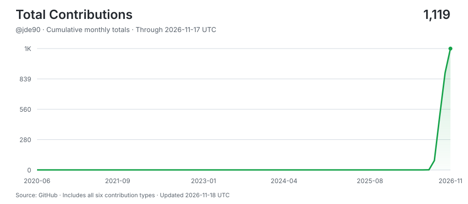

# jde90

<!-- aidevops:badges:start -->
<!-- managed by aidevops badges; edit the template, not this block -->

<!-- aidevops:badges:end -->

> Shipping with AI agents around the clock -- human hours for thinking, machine hours for doing.
>
> Stats auto-updated by [aidevops](https://aidevops.sh).

<!-- STATS-START -->
## Work with AI

| Metric | Yesterday | Prior 7 Days | Prior 28 Days | Prior 365 Days |
| --- | ---: | ---: | ---: | ---: |
| Screen time (Mac) | 4.8h | 34.5h | 91.8h | ~1714h* |
| Input activity (Mac) | 4h | 26.5h | 40.7h | ~1018h* |
| Interactive human attention | 2.3h | 24.8h | 52.8h | 486.5h |
| Interactive AI generation | 2.7h | 17.4h | 51.4h | 752.3h |
| Worker-classified human attention | 0.0h | 0.0h | 0.0h | 0.9h |
| Worker/headless AI generation | 3.6h | 14.1h | 54.3h | 211.7h |
| Additive observed work | 8.6h | 56.3h | 158.5h | 1,451.0h |
| Interactive sessions | 23 | 82 | 192 | 773 |
| Worker sessions | 75 | 305 | 1,014 | 4,352 |

_Screen time from screen-time-history:daily-observations; collection status: ok. *365-day estimate uses observed calendar coverage._

_Input activity from macos-input-activity:idle-cutoff-300s (time from each keyboard, mouse or trackpad input until 5 idle minutes); collection status: ok. Input sampling began 2026-11-10 (14.6 of 28 days sampled); earlier days are not counted. *365-day estimate uses sampled calendar coverage._

_Periods are completed local calendar days ending at midnight; today is excluded._

_Human attention is unioned wall-clock time, so overlapping sessions are not double-counted. AI generation is additive machine work across sessions; it is not wall-clock concurrency._

_AI session 365-day totals cover 153 days of local assistant session history (not extrapolated)._

## AI Model Usage (last 30 days)

| Model | Requests | Input | Output | Cache read | Cache write | Cache Hit-Rate % | Session Count | Session Hours |
| --- | ---: | ---: | ---: | ---: | ---: | ---: | ---: | ---: |
| claude-opus-5 | 16,128 | 32K | 4.4M | 1,431.4M | 80.7M | 94.7% | 1,046 | 62.8h |
| claude-sonnet-5-5 | 5,104 | 12K | 2.1M | 749.9M | 54.1M | 93.3% | 106 | 16.6h |
| claude-opus-5-5 | 3,437 | 7K | 1.8M | 528.4M | 21.6M | 96.1% | 20 | 13.3h |
| claude-fable-5-2 | 1,260 | 2K | 775K | 200.7M | 11.0M | 94.8% | 11 | 10.6h |
| gpt-5.6-terra | 1,243 | 8.6M | 395K | 81.7M | 0 | 90.4% | 94 | 6.4h |
| gpt-6.1-sol | 631 | 2.6M | 133K | 93.6M | 0 | 97.3% | 7 | 4.1h |
| gpt-5.6-luna | 358 | 6.9M | 367K | 5.6M | 0 | 45.0% | 56 | 2.6h |
| deepseek-v4.1-flash-free | 188 | 857K | 46K | 25.5M | 0 | 96.8% | 4 | 0.4h |
| gpt-6-luna | 33 | 130K | 3K | 2.5M | 0 | 95.1% | 1 | 0.2h |
| gpt-6.1-terra | 24 | 67K | 3K | 1.4M | 0 | 95.4% | 1 | 0.0h |
| gpt-6.2-astra | 18 | 446K | 5K | 1.4M | 0 | 76.4% | 1 | 0.1h |
| glm-5.3-flash-free | 12 | 97K | 571 | 439K | 0 | 81.8% | 1 | 0.0h |
| claude-haiku-5-5 | 9 | 20 | 1K | 551K | 72K | 88.3% | 1 | 0.0h |
| nemotron-3.5-lightning-free | 3 | 64K | 601 | 88K | 0 | 57.6% | 1 | 0.0h |
| **Total** | **28,448** | **19.9M** | **10.1M** | **3,123.6M** | **167.6M** | **94.3%** | **1,270** | **117.2h** |

_3,321.4M total tokens processed. 94.3% cache hit rate._

## AI Model Usage (all time)

| Model | Requests | Input | Output | Cache read | Cache write | Cache Hit-Rate % | Session Count | Session Hours |
| --- | ---: | ---: | ---: | ---: | ---: | ---: | ---: | ---: |
| claude-opus-5 | 62,388 | 124K | 22.0M | 11,946.4M | 481.0M | 96.1% | 2,338 | 250.1h |
| claude-sonnet-5 | 32,839 | 67K | 15.8M | 11,513.9M | 467.5M | 96.1% | 292 | 152.1h |
| gpt-5.6-sol | 15,334 | 70.0M | 3.4M | 1,270.5M | 0 | 94.8% | 800 | 80.3h |
| claude-opus-5-5 | 13,766 | 33K | 5.8M | 2,791.9M | 104.2M | 96.4% | 61 | 69.9h |
| big-pickle | 10,413 | 52.1M | 4.0M | 1,023.3M | 0 | 95.2% | 147 | 53.6h |
| claude-sonnet-5-5 | 10,074 | 24K | 4.0M | 1,808.0M | 111.0M | 94.2% | 142 | 35.4h |
| gpt-5.6-luna | 7,893 | 79.0M | 6.4M | 167.7M | 0 | 68.0% | 787 | 31.8h |
| claude-opus-4-8 | 5,837 | 11K | 6.9M | 1,606.9M | 98.3M | 94.2% | 46 | 42.5h |
| gpt-6.1-sol | 4,810 | 14.5M | 1.0M | 751.1M | 0 | 98.1% | 22 | 32.7h |
| gpt-5.6-terra | 4,419 | 41.7M | 1.2M | 329.5M | 0 | 88.7% | 396 | 24.5h |
| deepseek-v4-flash-free | 3,290 | 10.5M | 1.1M | 331.3M | 0 | 96.9% | 37 | 14.8h |
| gpt-5.5 | 2,285 | 8.8M | 389K | 140.5M | 0 | 94.1% | 301 | 9.8h |
| claude-fable-5-2 | 1,260 | 2K | 775K | 200.7M | 11.0M | 94.8% | 11 | 10.6h |
| gpt-6-luna | 885 | 6.7M | 146K | 120.8M | 0 | 94.7% | 25 | 3.7h |
| claude-sonnet-4-6 | 360 | 468 | 254K | 62.6M | 3.4M | 94.8% | 3 | 1.8h |
| deepseek-v4.1-flash-free | 289 | 2.3M | 64K | 40.2M | 0 | 94.4% | 8 | 0.7h |
| claude-opus-4-6 | 255 | 305 | 160K | 51.4M | 2.5M | 95.3% | 2 | 1.6h |
| muse-spark-1.2-contributor-free | 228 | 1.7M | 47K | 59.0M | 0 | 97.1% | 1 | 0.5h |
| deepseek-v4-pro | 211 | 951K | 81K | 41.3M | 0 | 97.8% | 3 | 0.8h |
| gpt-6-astra | 210 | 1.5M | 68K | 23.9M | 0 | 94.0% | 5 | 1.3h |
| claude-fable-5 | 187 | 374 | 159K | 32.6M | 2.8M | 91.9% | 6 | 1.2h |
| nemotron-3-ultra-free | 109 | 3.0M | 8K | 9.3M | 0 | 75.6% | 5 | 0.8h |
| longcat-2.5-preview-free | 102 | 149K | 9K | 12.3M | 0 | 98.8% | 1 | 0.3h |
| deepseek-v4-flash | 71 | 178K | 26K | 13.5M | 0 | 98.7% | 1 | 0.1h |
| gpt-5.4-mini | 53 | 1.3M | 4K | 4.0M | 0 | 75.1% | 1 | 1.2h |
| nemotron-3.5-lightning-free | 32 | 994K | 12K | 1.8M | 0 | 65.0% | 7 | 0.3h |
| muse-spark-1.3-contributor-free | 27 | 114K | 4K | 2.2M | 0 | 95.1% | 2 | 0.0h |
| gpt-6.1-terra | 24 | 67K | 3K | 1.4M | 0 | 95.4% | 1 | 0.0h |
| glm-5.3-flash-free | 20 | 250K | 913 | 1.4M | 0 | 85.4% | 2 | 0.0h |
| gpt-6.2-astra | 18 | 446K | 5K | 1.4M | 0 | 76.4% | 1 | 0.1h |
| claude-haiku-5-5 | 9 | 20 | 1K | 551K | 72K | 88.3% | 1 | 0.0h |
| claude-haiku-4-5 | 5 | 17 | 1K | 103K | 415K | 20.0% | 4 | 0.0h |
| mimo-v2.5-free | 5 | 454K | 3K | 16K | 0 | 3.5% | 5 | 0.0h |
| qwen2.5:14b-instruct-q4_K_M | 3 | 6K | 408 | 0 | 0 | 0.0% | 1 | 0.0h |
| gpt-5.6 | 2 | 0 | 0 | 0 | 0 | 0.0% | 2 | 0.0h |
| gpt-5.6-fast | 2 | 0 | 0 | 0 | 0 | 0.0% | 2 | 0.0h |
| pool-account-management | 2 | 0 | 0 | 0 | 0 | 0.0% | 2 | 0.0h |
| claude-fable-5-1 | 1 | 0 | 0 | 0 | 0 | 0.0% | 1 | 0.1h |
| claude-opus-4-8-fast | 1 | 0 | 0 | 0 | 0 | 0.0% | 1 | 0.0h |
| **Total** | **177,719** | **297.5M** | **74.6M** | **34,362.9M** | **1,282.7M** | **95.6%** | **4,918** | **823.0h** |

_36,017.8M total tokens processed. 95.6% cache hit rate._
<!-- STATS-END -->

<!-- PROJECTS-START -->
<!-- PROJECTS-END -->

<!-- CONTRIBUTIONS-START -->
## Contributions

- **[aidevops](https://github.com/marcusquinn/aidevops)** -- Vibe-Coding is easy. DevOps is hard. OpenCode & Git token-efficient AI agent automation for your app, business, and personal development. Opinionated tools, services, CLI & API stack for speed, security, and 24/7 results. Open-source first. SOTA everything. Try on your repos for money-making magic.
<!-- CONTRIBUTIONS-END -->

## Connect

---

<!-- UPDATED-START -->
_Stats auto-updated 2026-11-25 17:01 UTC by [aidevops](https://aidevops.sh) pulse._
<!-- UPDATED-END -->

<!-- TOTAL-CONTRIBUTIONS-START -->

  <a href="https://commit-history.com/jde90?metric=total" target="_blank" rel="noopener noreferrer">
    <picture>
      <source media="(prefers-color-scheme: dark)" srcset="assets/contributions/total-dark.svg" />
      
    </picture>
  </a>

[Verify on commit-history.com](https://commit-history.com/jde90?metric=total) · [Chart data](assets/contributions/total.json)

Includes commits, issues, pull requests, reviews, repositories, and restricted contributions. Refreshed daily through the prior UTC day; commit-history.com may use a different refresh cutoff. GitHub controls link navigation—Ctrl/Cmd-click opens verification in a new tab.
<!-- TOTAL-CONTRIBUTIONS-END -->
